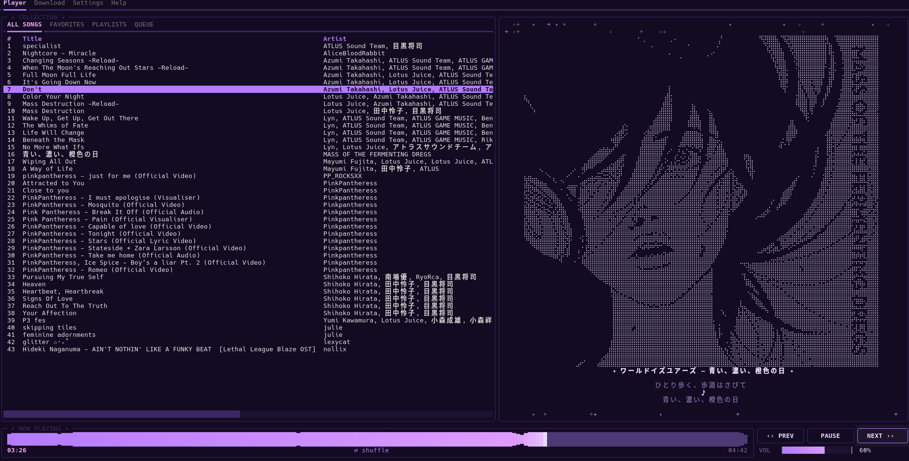

# Sonora

A terminal music app: download songs and albums with lyrics, then play them in a customizable purple TUI.



**Website:** https://github.com/yourname

## Install

**Linux** (Arch, Debian/Ubuntu, Fedora)

```bash
git clone https://github.com/PiizzS2/sonora.git
cd sonora
./install
sonora
```

**Windows**: needs Python 3.11+ (`winget install Python.Python.3.12`). Download the repo, double-click `install.bat` (use Windows Terminal, not the old cmd window), then run `sonora.bat`.

The installer sets up mpv, ffmpeg and a private Python venv, and creates a `sonora` command.

Press `?` to open the Help tab with every key (Esc or `?` again to go back).

## Config
Linux ~/.config/sonora/config.toml · Windows %APPDATA%\sonora\config.toml

## Keys (change them in ~/.config/sonora/config.toml)
F1 player · F2 download · Enter play/download · p pause · n/b next/prev
, / . seek · 1/2 volume · m shuffle · r repeat · q quit · ? every key

Collection (Player tab): tabs ALL SONGS / FAVORITES / PLAYLISTS / QUEUE (click, or press v)
  a add to playlist · ctrl+n new playlist · f favorite (works on the playing song too)
  w add to "up next" (song or whole playlist) · P play everything shown / the selected playlist
  shift+up / shift+down reorder inside a playlist or favorites · s sort (file, title, artist, album, recent)
  e fix a song's album (or rename a playlist) · d remove from playlist/favorites/queue, or delete a playlist
  D delete the song file from disk (asks first, refuses the playing song)
  L lyrics menu: other source, different artist/title, load from a file, remove · l quick re-fetch
  Enter opens a playlist / plays a row · Esc or Backspace goes back
Queue tab: "up next" songs play first, then the rest of the list you started from. Enter jumps to a row, d removes it.
Sonora remembers volume, shuffle, repeat, sort and the last song + position (paused on launch).
Files in <config dir>/sonora: collection.json (playlists, favorites, album fixes), state.json (last session).
To revert: put back the old sonora.py and delete those json files.

## Downloading
F2, type a song name + Enter, pick a result + Enter.
For an album: paste a YouTube Music album or playlist URL.
Files go to ~/Music/Sonora/Artist/Album/, with a .lrc lyrics file next to each song.
Lyrics are tried in order: LRCLIB (synced) -> AZLyrics -> Genius (set `lyrics_sources` in config.toml).

Download queue: keep pasting links / picking results while one is running, they download one after another.
CANCEL stops the current one; press it again when idle to clear the waiting list.
Search results marked with ✓ are already in your library; album/playlist downloads skip songs you already have.

## Settings tab: library tools
MISSING LYRICS fetches lyrics for every song that has none (press again to stop). Songs not found are remembered
and skipped next time (use L on a song to retry one). RESCAN re-reads the music folder.

## Splash
On start a star spins up and turns into the SONORA logo; on quit it plays backwards (and the music fades out).
Any key skips it. Turn it off with `splash = false` under [player] in config.toml.

## Troubleshooting
Downloads fail -> press UPDATE on the Download page (or U) to update yt-dlp, then restart Sonora if it says so.
